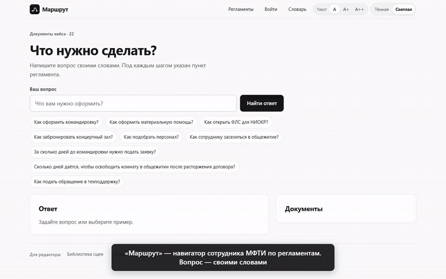
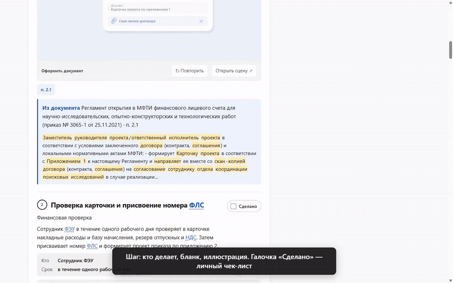
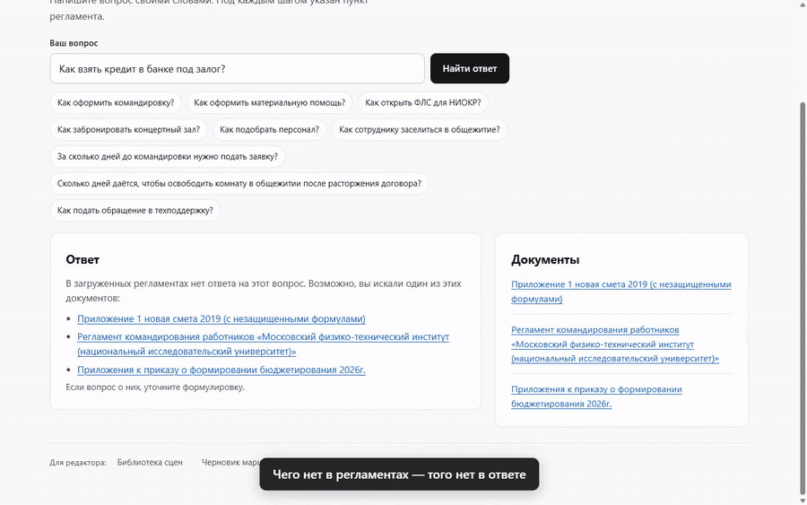
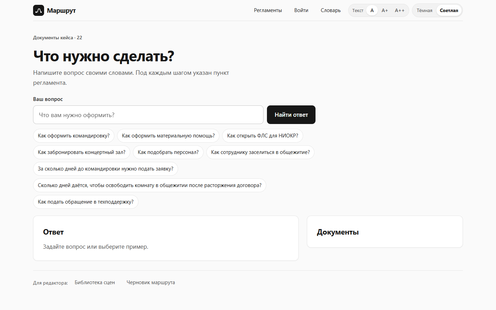
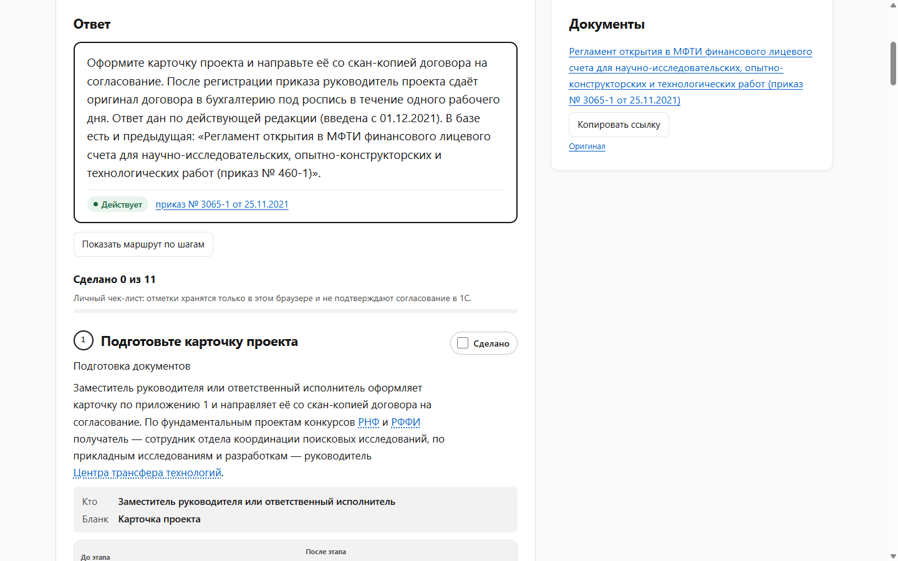
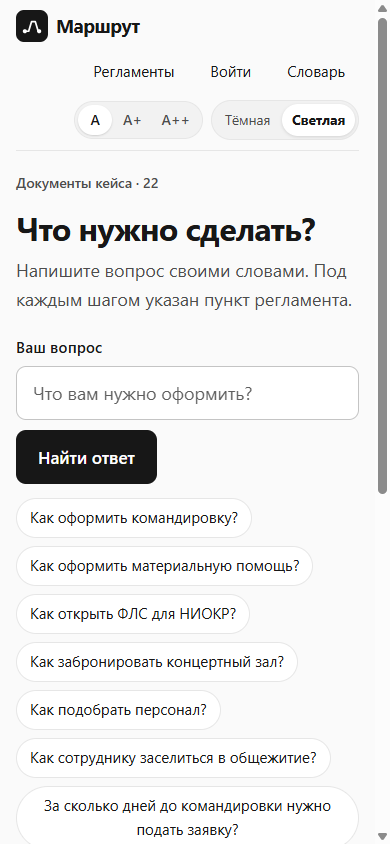

# Маршрут — навигатор сотрудника по регламентам

[](https://github.com/alteralto/marshrut/actions/workflows/ci.yml)

Сотрудник МФТИ спрашивает своими словами — «как открыть ФЛС», «кто утверждает смету». «Маршрут» находит действующий регламент и отвечает порядком действий: кто, что делает, к какому сроку, с каким бланком. У каждого шага — пункт приказа и страница оригинала. Если ответа в регламентах нет, система так и говорит.

Решение трека 04 «Навигатор сотрудника по внутренним регламентам» хакатона «ИИ в системе управления МФТИ».

**[Открыть стенд](https://176-53-224-203.sslip.io)** · **[Скринкаст, 1,5 мин](docs/demo/marshrut-screencast.mp4)** · **[Презентация (PDF)](docs/pitch/Маршрут-презентация.pdf)** · **[Архитектура](docs/ARCHITECTURE.md)** · **[Запуск за 10 минут](#проверка-за-10-минут)** · **[Персональные данные](#персональные-данные-и-маскировка)**



**Главный принцип — точность важнее полноты.** Каждый шаг ответа проверяется по тексту пункта, на который он ссылается: слова, числа, отрицания. Шаг, который пункт не подтверждает, отбрасывается. Если подтверждённого ответа нет, система прямо говорит «в регламентах нет ответа», а не угадывает.

| | |
|---|---|
| **0 выдумок** на вопросах вне базы в слепой проверке | **43 из 43** — документ кейса найден первым |
| **96,6%** нарочно подменённых шагов отсеяно проверкой | **1190 документов** 43 вузов, ответ без модели — 8 мс |

## Как это выглядит

| Под каждым шагом — пункт приказа, подсвечено взятое из текста | Чего нет в регламентах — честный отказ и близкие документы |
|---|---|
|  |  |

| Главная | Ответ по действующей редакции | Шаг с доказательством | Телефон |
|---|---|---|---|
|  |  |  |  |

Схемы: [система как чёрный ящик](docs/architecture/1-black-box.png) и [что внутри](docs/architecture/2-inside.png).

## Быстрый запуск

Нужны Docker 24+ с Compose v2, около 1 ГБ места и интернет на время сборки образа. Видеокарта и внешние сервисы не нужны.

1. Положить выданные документы в папку `corpus/case/` (в архиве решения они уже лежат).
2. Собрать и запустить:
   ```sh
   docker compose up --build -d
   ```
3. Открыть http://localhost:8787. Код редактора для загрузки документов и публикации маршрутов — `demo` (кнопка «Войти»). На общем сервере задайте свой код через `EDITOR_TOKEN`.
4. Остановить: `docker compose down`. Загруженные документы и маршруты остаются в томе `marshrut-data`; удалить их вместе с контейнером — `docker compose down -v`.

### Проверка за 10 минут

После `docker compose up --build -d` (первая сборка несколько минут):

1. `docker compose ps` — контейнер `healthy`; `curl http://localhost:8787/health` — `{"ok":true,…}`.
2. http://localhost:8787/report — 22 документа, список непрочитанных файлов пуст. Если документов меньше, причина указана в отчёте; логи — `docker compose logs --tail=100 marshrut`.
3. Три вопроса в интерфейсе:
   - «Как открыть ФЛС для НИОКР?» — приказ № 3065-1, шаги с исполнителями и сроками, пометка о предыдущей редакции (№ 460-1);
   - «За сколько дней до командировки нужно подать заявку?» — 7 рабочих дней, п. 53, страница 13 оригинала;
   - «Как взять кредит в банке?» — «в регламентах нет ответа», шагов нет.
4. Нажать ссылку на пункт в любом шаге — откроется документ с подсветкой пункта; ссылка «PDF · стр.» открывает оригинал на этой странице.

Проверено 14.11.2026 из чистой копии репозитория: `docker compose build --no-cache` — 30 с (тексты сканов из поставки лежат в `corpus/extracted`, повторное распознавание не нужно; без них сборка распознаёт сканы Tesseract за несколько минут), контейнер `healthy`, `/report` — 22 документа и 0 ошибок чтения, три вопроса выше дают ожидаемые документ, пункт и отказ.

Без ключей и интернета поставка отвечает дословными выдержками из пунктов; формулировки на публичном стенде с GigaChat отличаются, документы и пункты — те же.

При сборке образ один раз читает все документы из `corpus/case/`, включая распознавание сканов, поэтому сборка занимает несколько минут, а запуск — секунды. Отчёт о чтении каждого файла печатается в конце сборки и доступен по адресу `/report`.

## Запуск без Docker

Нужны Node.js 22+, Poppler (`pdftotext`, `pdftoppm`) и Tesseract с русским языком. В Windows вместо Tesseract используется встроенное распознавание, достаточно Poppler. Установка npm-пакетов не требуется.

```sh
node app/server.js            # запуск, остановка — Ctrl+C
node app/server.js --prepare  # только прочитать документы и напечатать отчёт
npm --prefix rag test         # тесты ядра
node --test app/trip.test.js   # вопрос о сроке подачи заявки
```

Если OCR установлен в отдельной папке, передайте пути к `pdftotext`, `pdftoppm` и `tesseract` через `RAG_PDFTOTEXT`, `RAG_PDFTOPPM` и `RAG_TESSERACT`. Для отдельной папки с `rus.traineddata` задайте `TESSDATA_PREFIX`. После запуска откройте `/report`: там видны метод обработки и ошибки по каждому файлу.

## Развёртывание на сервере

Сервер с Ubuntu 24.04, 2 vCPU и 4 ГБ памяти, открыты порты 22, 80 и 443. Модель и видеокарта не нужны.

```sh
git archive HEAD | ssh root@<ip> "mkdir -p /opt/marshrut && tar -x -C /opt/marshrut"
ssh root@<ip> "cd /opt/marshrut && EDITOR_TOKEN=<код> READER_TOKEN=<код> bash deploy/setup.sh"
```

Скрипт ставит Docker и Caddy, включает межсетевой экран, записывает коды в `/opt/marshrut/.env`, собирает образ и запускает приложение только на 127.0.0.1. Caddy получает сертификат Let's Encrypt и отдаёт приложение по HTTPS. Без своего домена адрес будет `https://<ip-через-дефисы>.sslip.io`, свой домен передаётся первым аргументом скрипта. Обновление: снова распаковать архив и выполнить `docker compose up --build -d`, документы и маршруты остаются в томе.

## Настройки

| Переменная | По умолчанию | Назначение |
|---|---|---|
| `PORT` | `8787` | Порт приложения |
| `HOST` | `127.0.0.1`, в Docker `0.0.0.0` | Адрес, на котором слушает сервер |
| `DATA_DIR` | `data`, в Docker `/data` | Загруженные файлы, их тексты и опубликованные маршруты |
| `CORPUS_DIRS` | `corpus/case` | Папки с документами из поставки, через запятую |
| `EDITOR_TOKEN` | пусто | Код редактора. Даёт доступ к внутренним документам, загрузке, публикации и настройке доступа |
| `READER_TOKEN` | пусто | Отдельный код читателя для поиска и просмотра внутренних документов |
| `SECURE_COOKIES` | `0` | Задайте `1`, если приложение доступно пользователям по HTTPS |
| `LLM_BASE_URL`, `LLM_MODEL`, `LLM_API_KEY` | пусто | Языковая модель с интерфейсом OpenAI. Без неё ответ собирается из дословных выдержек |
| `GIGACHAT_CREDENTIALS`, `GIGACHAT_SCOPE`, `GIGACHAT_MODEL` | пусто, `GIGACHAT_API_PERS`, `GigaChat-2-Max` | Ключ авторизации GigaChat вместо `LLM_BASE_URL`. Токен на 30 минут приложение получает и обновляет само |
| `ALLOW_EXTERNAL_LLM` | пусто | `1` разрешает модель вне локальной сети, в том числе GigaChat. По умолчанию такой адрес и ключ игнорируются |
| `RAG_OCR` | включено | `0` выключает распознавание сканов |
| `RAG_OCR_LANG`, `RAG_OCR_DPI` | `rus`, `300` | Язык и разрешение распознавания Tesseract |
| `RAG_PDFTOPPM`, `RAG_PDFTOTEXT`, `RAG_TESSERACT` | из `PATH` | Пути к утилитам, если они не в `PATH` |
| `RAG_PDFSEPARATE` | рядом с `RAG_PDFTOTEXT` или из `PATH` | Выгрузка страницы исходного PDF как отдельного бланка |

Переменные можно записать в файл `.env` рядом с `docker-compose.yml`.

## Доступ к документам

Войдите с кодом редактора и откройте «Регламенты». Для каждого документа можно выбрать «Открытый» или «Только после входа». Новые загрузки закрыты по умолчанию. Файлы из поставки открыты, пока редактор не изменит режим. Настройки привязаны к содержимому файла и сохраняются в `DATA_DIR/access.json`.

Код читателя даёт право читать внутренние регламенты и пользоваться поиском по ним. У гостя закрытый документ отсутствует в списке и поиске, а прямые адреса оригинала, текста, бланков и маршрута не открываются. Внутренние документы не передаются внешней модели: если среди найденных есть закрытый документ, ответ собирается из выдержек. Сеанс действует восемь часов, а выход или перезапуск сервера завершает его.

Для общего сервера используйте разные длинные коды редактора и читателя, HTTPS и `SECURE_COOKIES=1`. Коды общие для роли. Если нужны индивидуальные права и журнал действий по сотрудникам, подключите учётные записи организации. Внутренние файлы загружайте на работающий сервер, чтобы они не попадали в распространяемый образ. Ограничения приложения защищают доступ через сервер. Шифрование диска и резервных копий настраивается на стороне хостинга.

## Персональные данные и маскировка

В регламентах встречаются ФИО, телефоны и почта: в листах согласования, в контактах ответственных. Правила кейса разрешают отправлять во внешние сервисы только открытые и неконфиденциальные данные, поэтому в решении три уровня защиты:

1. **Без внешней модели ничего не покидает сервер.** Поиск, проверка шагов и ответ работают внутри контейнера; это режим по умолчанию.
2. **Закрытые документы не уходят в модель вообще.** Редактор помечает документ «Только после входа». Если такой документ попадает в ответ, модель не вызывается, ответ строится дословными выдержками.
3. **Маскировка перед отправкой.** Из найденных пунктов и из вопроса до отправки во внешнюю модель вырезаются ФИО (полные, с инициалами до и после фамилии), телефоны и адреса почты (`rag/src/redact.js`). Должности остаются: они и есть содержание правила.

Пример — что уходит в модель:

| Текст пункта | Что получает модель |
|---|---|
| Карточку согласует начальник ФЭУ Иванова Анна Сергеевна (тел. +7 (495) 408-45-54, ivanova.as@mipt.ru), приказ подписывает проректор А.В. Петров. | Карточку согласует начальник ФЭУ [ФИО] (тел. [телефон], [e-mail]), приказ подписывает проректор [ФИО]. |

Маскировка работает по шаблонам и проверена тестами (`rag/test/gigachat.test.js`), но не гарантирует распознавание любой формы фамилии. Поэтому документы, где персональные данные — основное содержание, стоит помечать «Только после входа»: тогда они не покидают сервер ни в каком виде. Пользователю внутри МФТИ документ показывается полностью, как в оригинале.

## Внешние сервисы

По умолчанию их нет: тексты документов и вопросы не покидают контейнер.

Внешняя модель включается только явно, через `ALLOW_EXTERNAL_LLM=1`. Тогда действуют правила кейса о внешних API:

- модели передаются только найденные пункты открытых документов. Если в ответ попадает документ «Только после входа», модель не вызывается;
- из пунктов и вопроса до отправки вырезаются ФИО (полные и с инициалами), телефоны и адреса почты, `rag/src/redact.js`. Должности остаются, потому что они и есть содержание правила: «смету утверждает курирующий проректор»;
- ключ передаётся только серверу авторизации. Сертификат Минцифры, которым подписаны серверы GigaChat, лежит в `rag/certs/` и используется только для запросов к GigaChat. В систему и в остальные соединения приложения он не устанавливается.

Демонстрационный стенд работает с GigaChat:

```sh
GIGACHAT_CREDENTIALS=<ключ авторизации> ALLOW_EXTERNAL_LLM=1 docker compose up --build -d
```

Внутри организации модель ставится рядом с приложением. В составе есть профиль с Ollama:

```sh
LLM_BASE_URL=http://ollama:11434/v1 LLM_MODEL=qwen2.5:7b docker compose --profile llm up --build -d
docker compose exec ollama ollama pull qwen2.5:7b
```

С моделью меняется только формулировка краткого ответа и шагов. Документ и пункты по-прежнему выбирает поиск. Каждый шаг и краткий ответ модели проверяются по тексту пунктов, на которые они ссылаются: слова, числа и отрицания должны найтись в пункте. Непроверенные шаги отбрасываются, а если не прошёл ни один, показываются дословные выдержки. Слово, в которое модель вставила латинские буквы, восстанавливается по тексту пункта.

## Что получает пользователь

| Требование кейса | Как выполнено |
|---|---|
| Краткий ответ | Предложение из найденного пункта, которое отвечает на вопрос, со ссылкой на пункт |
| Пошаговый порядок действий | Пункты раздела, описывающего процедуру, в порядке документа; у шага выделены исполнитель, срок и документ |
| Название документа | Название регламента, номер и дата приказа, имя файла |
| Ссылка на пункт | Номер пункта, переход к нему в тексте, для PDF — страница оригинала |
| Сообщение, если ответа нет | Отдельное сообщение и список ближайших по словам документов |
| Несколько документов | Выдержки из второго документа рядом с ответом; при близких документах — просьба уточнить вопрос |
| Дата и редакция | Из двух редакций одного регламента используется действующая, о предыдущей сообщается |

У шагов, к которым в материалах кейса есть форма, доступны «Открыть бланк» и скачивание. Карточку проекта можно заполнить в браузере и скачать как DOCX на основе приложения 1 к регламенту открытия ФЛС. Сервер формирует файл в памяти из значений полей и возвращает его через `POST /forms/project-card/filled`. Введённые значения не сохраняются в базе. Формы сметы 1а и 1б скачиваются из файлов кейса. Привязки к документам и пунктам заданы в `app/forms.js`. Ответ и черновик передают `steps[].forms`, файлы отдаются через `GET /forms/:id`.

## Типовые сценарии

**1. Порядок действий.** Вопрос: «Как открыть ФЛС для НИОКР?»
Ожидается: документ «Регламент открытия в МФТИ финансового лицевого счета… (приказ № 3065-1 от 25.11.2021)», файл `Приказ N 3065-1 от 25.11.2021.docx`; шаги по пунктам 2.1–2.9 с исполнителями и сроками; примечание, что ответ дан по редакции, действующей с 01.12.2021, а в базе есть и предыдущая (приказ № 460-1).

**2. Срок.** Вопрос: «За сколько дней до командировки нужно подать заявку?»
Ожидается: краткий ответ «Не позднее чем за 7 рабочих дней до командировки, работник представляет Решение о командировании в группу командирования ОМС», ссылка на п. 53 и страницу 13 файла `Регламент о командировании.pdf`.

**3. Ответа нет.** Вопрос: «Как взять кредит в банке?»
Ожидается: «В загруженных регламентах нет ответа на этот вопрос»; если похожие слова есть в документах — ссылки на них. Шаги не выводятся.

**4. Новый документ.** В «Библиотеке» загрузить PDF-скан, DOCX и повреждённый файл одной пачкой.
Ожидается: скан распознан и разбит на пункты с пометкой «текст распознан со скана», DOCX добавлен, по повреждённому файлу указана причина. Вопросы по новым документам работают сразу, изменений в коде не требуется.

**5. Маршрут редактора.** В «Черновике маршрута» выбрать регламент, сверить предложенные шаги с оригиналом и отметить, какие включить. Можно добавить пропущенный пункт, отредактировать заголовок и текст шага, выбрать сцену, исправить чек-лист и прикрепить страницу исходного PDF как бланк. Схема и чек-лист доступны для проверки до публикации.
Ожидается: на вопрос «Как…» по этому регламенту показывается опубликованный маршрут; ссылка `/?route=<id>` открывается с другого компьютера.

## Проверка качества

Набор `rag/fixtures/case-questions.json`: 51 вопрос по 22 документам базы (20 выданы организаторами, 2 регламента взяты с сайта МФТИ: материальная помощь обучающимся и переход с платного обучения на бесплатное), из них 8 без ответа в базе. Вопросы составлены авторами решения. Режим без модели.

| Показатель | Результат |
|---|---|
| Нужный документ выбран первым | 43 из 43 |
| Нужный документ среди трёх первых | 43 из 43 |
| Нужные пункты среди показанных (41 вопрос с размеченными пунктами) | 78% |
| Ложный отказ «ответа нет» | 0 из 43 |
| Верный отказ, когда ответа нет | 7 из 8 |

Промах: на вопрос «Какой размер стипендии у аспирантов?» система отвечает пунктами регламента матпомощи, потому что там есть «стипендиальные комиссии» и «размер помощи». Вопрос «Как получить материальную помощь?» раньше считался вопросом без ответа; после добавления регламента матпомощи в базу он стал обычным вопросом. Порог отказа подобран на этом же наборе и стоит близко к границе: при добавлении новых документов число верных отказов может измениться.

Поиск настраивался на этом наборе, поэтому для контроля есть отложенный набор `rag/fixtures/real-test.json` (30 вопросов по открытым регламентам МФТИ и других вузов), на котором ничего не настраивалось. Нужный документ первым на нём выбирается в 21 вопросе из 30, в первой тройке — в 28 из 30 (замер 14.11.2026; команды — в `corpus/README.md`).

Повторить:

```sh
node rag/cli.js ingest corpus/case --out rag/data/case-index.json --no-embed
node rag/eval/run-eval.js --questions rag/fixtures/case-questions.json --index rag/data/case-index.json --mode extractive --verbose
```

Цифры получены на индексе, который строит приложение, 14.11.2026. Тексты сканов в Windows (встроенное распознавание) и в Docker (Tesseract) немного различаются, поэтому доля найденных пунктов может отличаться на несколько процентов.

Часть частых вопросов («Как оформить командировку?», «Как открыть ФЛС для НИОКР?», бронирование концертного зала, подбор персонала) отвечается готовым маршрутом, который редактор сверил с пунктами регламента. Остальные вопросы ядро отвечает дословными выдержками из найденных пунктов.

Скорость на ноутбуке, без модели:

| База | Сборка индекса | Ответ, медиана | Ответ, 95% |
|---|---|---|---|
| 22 документа, 2,6 тыс. пунктов | 0,2 с | 1,4 мс | 2,9 мс |
| 700 документов, 81 тыс. пунктов | 2,8 с | 3,9 мс | 6,5 мс |
### Слепая проверка экспертом

Отдельный проверяющий, не видевший кода и наших наборов, прочитал 22 документа и до первого обращения к системе написал 40 вопросов от лица сотрудников МФТИ: обычные, ловушки (согласует или утверждает, исключения, ложная предпосылка), вопросы на два документа и правдоподобные вопросы, ответа на которые в базе нет. Потом задал их стенду с GigaChat и оценил каждый ответ. Вопросы и оценки — замороженный набор, по нему ничего не настраивалось.

| Тип вопроса | Всего | Верно | Частично | Неверно | Ложный отказ | Верный отказ | Выдумка |
|---|---|---|---|---|---|---|---|
| Обычные | 21 | 12 | 6 | 1 | 2 | — | — |
| Ловушки | 7 | 4 | 1 | 1 | 1 | — | — |
| На два документа | 4 | 0 | 1 | 1 | 2 | — | — |
| Ответа в базе нет | 8 | — | — | — | — | 8 | 0 |
| **Итого** | **40** | **16** | **8** | **3** | **5** | **8** | **0** |

На вопросы вне базы система ни разу не придумала ответ. Когда система отвечает, документ выбран верно во всех случаях; промахи по документу — только ложные отказы (5 из 32), что соответствует принципу «лучше отказать, чем ошибиться». Три неверных ответа — подмена условия: ветка для оборонных работ вместо обычной НИР, лимит «из федерального бюджета» вместо планового, общий порядок вместо исключения для РНФ. По итогам проверки исправлено: очередь запросов к GigaChat (при вопросах подряд модель отвечала «слишком много запросов», и ответы молча уходили в режим без модели), под коротким ответом без шагов показываются только 3 опорных пункта, пункты без собранного действия больше не выглядят как шаги с галочками.

### Нагрузка: 1190 настоящих документов

Замер 14.11.2026 на ноутбуке (i5-11400H, 6 ядер). С разделов «Сведения об образовательной организации» 43 вузов скачаны все доступные PDF и DOCX до 8 МБ — 1168 файлов, без отбора, вместе со сканами — и добавлены к 22 документам кейса.

| Что | Результат |
|---|---|
| Чтение 1168 файлов тем же разбором, что в приложении | все прочитаны: 804 PDF с текстом, 360 сканов (3325 страниц распознано Tesseract), 4 DOCX; 53 мин в 10 потоков в Docker |
| База после разбора | 1166 документов, 123 тыс. пунктов |
| Пересборка индекса | 21 с, память процесса около 1 ГБ |
| Ответ без модели | медиана 7,7 мс, 95% — 15,5 мс |
| Документ кейса первым среди 1166 | 38 из 43 (88%), в первой тройке 42 из 43 (98%); нужные пункты 69% |
| Ложный отказ | 0 из 43 |

Все пять промахов по документу — регламент на ту же тему другого вуза (например, командирование в ИГУ вместо МФТИ). По той же причине из 8 «вопросов без ответа» 6 получили ответ из чужих регламентов: академический отпуск, стипендии, защита диссертаций там есть. В базе одной организации такого не будет; при общей базе нескольких организаций нужен фильтр по источнику документа.

### Распознавание сканов

Замер 14.11.2026: страницы с известным текстом (выдержки из приказов кейса, A4, 300 dpi) в трёх вариантах — чистая печать, обычный скан, плохая серая ксерокопия с наклоном 2° и разрешением 150 dpi; настоящий скан регламента матпомощи с выверенным текстом; 34 страницы реальных сканов МФТИ для времени. Доля ошибочных символов (CER), меньше — лучше.

| Распознаватель, где | Чистая печать | Скан | Плохой скан | Реальный скан | Секунд на страницу реального скана |
|---|---|---|---|---|---|
| Tesseract 5.3 rus (как в образе), ноутбук i5-11400H | 0,3% | 0,3% | 92% | 10% | 1,9 |
| то же, одно ядро | 0,3% | 0,3% | 92% | 10% | 2,2 |
| EasyOCR ru, GPU RTX 3060 Laptop | 3,5% | 3,2% | 32% | 11,5% | 5,4 |

Tesseract точнее и быстрее на нормальных сканах, EasyOCR на GPU медленнее, но заметно лучше читает плохие: видеокарта нужна не для скорости, а для второго прохода по плохим страницам. Одна страница у Tesseract считается почти в один поток, поэтому одно ядро медленнее всего на 15%, а ускорение даёт только распознавание нескольких страниц параллельно. На реальном скане часть «ошибок» — расхождение с эталоном (штампы и шапка, которых нет в выверенном тексте); настоящие ошибки — латиница, прочитанная кириллицей (`mipt.ru`), и номера пунктов, прочитанные отдельной колонкой. Загрузка скана выполняется в отдельном потоке и не останавливает ответы на вопросы.


База на 700 документов получена копированием выданных 20, поэтому это замер скорости, а не качества.

## API

| Запрос | Ответ |
|---|---|
| `POST /ask` `{"question": "…"}` | `summary`, `steps[]` с `cites[]` (документ, пункт, цитата, страница), `document`, `documents`, `related`, `notices`, `not_found`, `message` |
| `GET /docs`, `GET /report` | Документы базы с паспортом и отчётом о разборе; `/report` добавляет непрочитанные файлы с причинами |
| `GET /doc/:id`, `?format=html` | Документ по пунктам; HTML-вид с якорями пунктов |
| `GET /original/:id` | Исходный файл; PDF открывается на странице `#page=N` |
| `POST /import` | Загрузка файлов (`multipart/form-data`, поле `files`), ответ с отчётом по каждому файлу |
| `GET /routes`, `GET /routes/draft?id=`, `POST /routes/publish`, `GET /routes/published?id=` | Маршруты редактора |
| `GET /health` | Состояние сервера и индекса |

## Архитектура

Один процесс Node.js: интерфейс, библиотека документов, поисковое ядро и маршруты редактора. Компоненты, поток данных при загрузке документа и при вопросе, формат хранения описаны в [docs/ARCHITECTURE.md](docs/ARCHITECTURE.md), схемы в нотации C4 — в [docs/C4.md](docs/C4.md).

Кратко о потоке: файл → текст по страницам (для скана — распознавание) → пункты и строки таблиц → паспорт документа и связь редакций → индекс. Вопрос → выбор документа → проверка, что документ об этом → пункты лучшего раздела → краткий ответ, шаги и ссылки.

## Ограничения и развитие

- Распознанные сканы содержат опечатки в отдельных словах; номера пунктов и сроки стоит сверять с оригиналом, ссылка на страницу для этого есть в каждом шаге.
- Статус «действует» означает, что в загруженной базе нет документа, который отменяет или заменяет этот. Если отменяющий приказ не загружен, система об этом не узнает: например, бланк сметы 2019 года помечен «действует», хотя приказ 794-1 вводит новые формы 1а и 1б, но прямо его не отменяет.
- Противоречия между разными документами не вычисляются автоматически. Показываются смена редакций, отменённые и изменённые документы.
- Вопросы, ответ на которые лежит в двух документах сразу, и условия-исключения внутри пункта («для работ по ГОСТ РВ», «за счёт федерального бюджета») — самое слабое место: в слепой проверке полностью верных ответов на два документа 0 из 4. Проверка шагов ловит подмену числа, но не подмену условия, к которому число относится.
- Плохие сканы (серая ксерокопия, наклон, низкое разрешение) Tesseract почти не читает — см. замер ниже. Следующий шаг: второй проход другим распознавателем, если текст первого похож на мусор.
- На публичном стенде используется личный ключ GigaChat: один запрос одновременно. Вопросы ждут в очереди, при отказе модели ответ строится по пунктам без неё, и это написано в ответе.
- Отметки «Сделано» — личный чек-лист в браузере, они не связаны с 1С. Подключение к 1С:Документообороту (источник приказов и статусов согласования) — следующий этап, его нужно проектировать вместе с УИТ МФТИ.
- Три роли (гость, читатель, редактор) с общими кодами на роль. Для внедрения нужны учётные записи организации и журнал действий.
- Поиск лексический. Вопросы, в которых нет ни одного слова из документа и его синонимов, остаются без ответа; следующий шаг — смысловой поиск на локальной модели эмбеддингов, ядро его поддерживает (`EMBED_BASE_URL`), в поставку он не включён.

## Состав репозитория

| Папка | Содержимое |
|---|---|
| `app/` | Сервер приложения, библиотека документов, интерфейс |
| `rag/` | Поисковое ядро: извлечение текста, разбор, индекс, поиск, сборка ответа, тесты и замеры |
| `corpus/case/` | Документы из поставки |
| `notes/asset-library/` | Библиотека сцен для маршрутов |
| `docs/` | Архитектура и заметки для разработчика |
