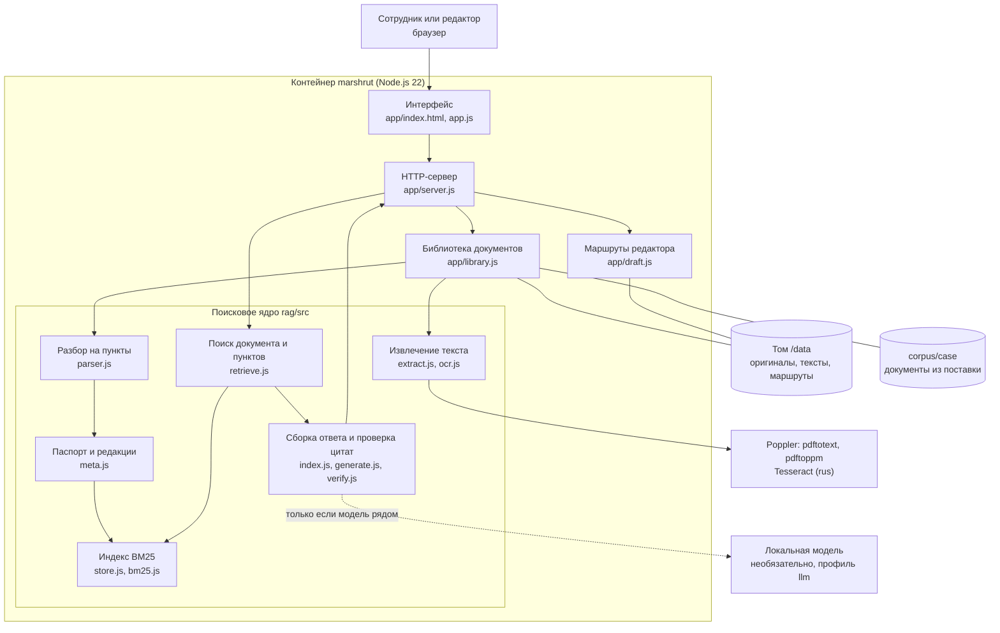
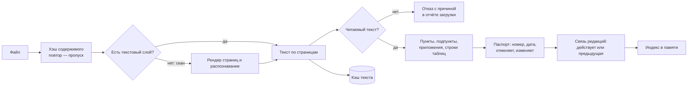
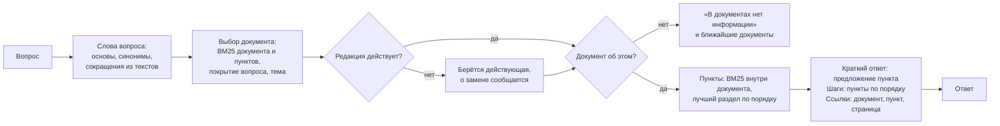

# Архитектура «Маршрута»

Схемы в нотации C4 (контекст, контейнеры, компоненты, путь вопроса, развёртывание) — в [C4.md](C4.md).

Один процесс Node.js без npm-зависимостей. Он раздаёт интерфейс, хранит библиотеку документов, отвечает на вопросы и хранит маршруты, проверенные редактором. Чтение PDF и распознавание сканов выполняют системные утилиты Poppler и Tesseract, они входят в образ Docker.

## Компоненты

| Компонент | Что делает |
|---|---|
| `app/server.js` | Маршрутизация запросов, раздача интерфейса и оригиналов, проверка кода редактора, запрет запросов с чужих сайтов |
| `app/library.js` | Хранит оригиналы по хэшу содержимого, один раз извлекает текст и кладёт его в кэш, собирает индекс в памяти |
| `rag/src/extract.js` | Текст из PDF, DOCX, XLSX, HTML, TXT, MD. Для PDF запоминает границы страниц |
| `rag/src/ocr.js` | Распознаёт сканы: страницы рендерит `pdftoppm`, распознаёт Tesseract (в Windows — встроенное распознавание) |
| `rag/src/parser.js` | Делит текст на пункты, подпункты, приложения и строки таблиц; отделяет приказ от утверждённого им регламента |
| `rag/src/meta.js` | Паспорт документа: вид, номер, дата, что утверждает, что отменяет или меняет. Связывает редакции одного регламента |
| `rag/src/store.js`, `bm25.js` | Обратный индекс по пунктам и по документам, отчёт о качестве разбора |
| `rag/src/retrieve.js` | Выбирает документ и пункты, решает, есть ли ответ в базе |
| `rag/src/index.js`, `generate.js`, `verify.js` | Краткий ответ, шаги, ссылки на пункты; при работе с моделью — проверка каждого шага по тексту пункта |
| `app/draft.js` | Черновик маршрута из пунктов регламента, публикация после сверки редактором |

## Поток данных: загрузка документа

Текст извлекается один раз на файл. Перезапуск и новая загрузка пересобирают только индекс в памяти из кэша текстов. Битый файл, пустой PDF или скан без распознавания не останавливают пачку: остальные файлы загружаются, а по этому в ответе стоит причина.

## Поток данных: вопрос

Решение «ответа нет» принимается до сборки ответа и без модели: по доле слов вопроса, найденных в документе, и по тому, является ли предмет вопроса темой документа (стоит в названии, заголовках или встречается не один раз).

Без модели ответ состоит из дословных выдержек, поэтому в нём нет сведений вне документов. С моделью каждый шаг проходит проверку: в нём должны быть ссылки на пункты, а числа, сроки и содержательные слова шага должны находиться в тексте этих пунктов. Шаг, не прошедший проверку, отбрасывается; если не прошёл ни один, ответ собирается из выдержек.

## Хранение

| Где | Что |
|---|---|
| `corpus/case/` | Документы из поставки. Читаются при сборке образа, результат лежит в образе |
| `/data/originals/<sha256>.<расширение>` | Загруженные файлы в исходном виде |
| `/data/texts/<sha256>.json` | Извлечённый текст загруженного файла с границами страниц |
| `/data/library.json` | Список загруженных файлов: имя, хэш, дата, ссылка на источник |
| `/data/routes/<id>.json` | Опубликованный маршрут: утверждённые пункты, тексты чек-листа и отпечаток редакции документа, по которой шла сверка |

Опубликованный маршрут привязан к отпечатку разобранного документа. Если документ заменили, маршрут помечается как требующий повторной сверки и в ответы не подставляется.

## Границы решения

- Один процесс и индекс в памяти: загрузка выполняется по очереди, распознавание большого скана занимает сервер на время распознавания.
- Три роли по общим кодам: гость, читатель (`READER_TOKEN`) и редактор (`EDITOR_TOKEN`). Учётных записей и журнала действий нет.
- HTTPS не встроен: при размещении в сети перед приложением ставится обратный прокси организации.
- Противоречия между разными документами не вычисляются. Пользователь видит смену редакций, отменённые и изменённые документы, а при близких документах — просьбу уточнить вопрос и выдержки из обоих.
