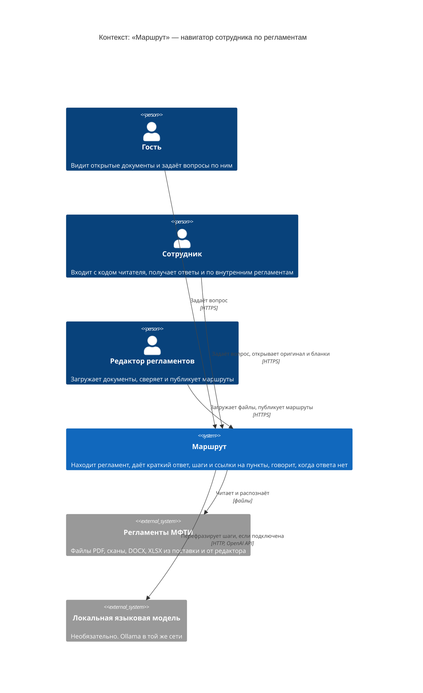
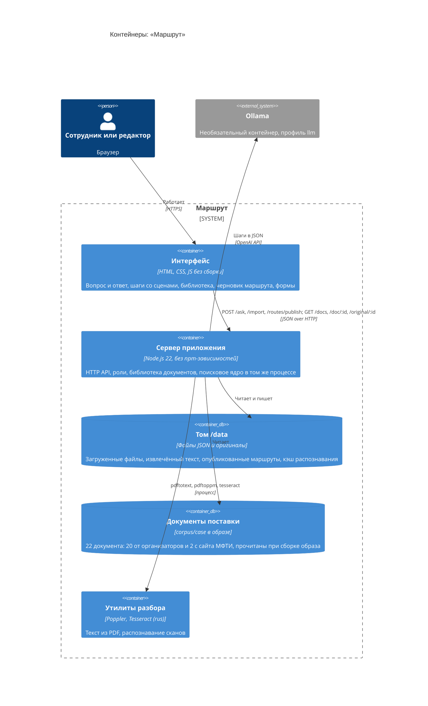
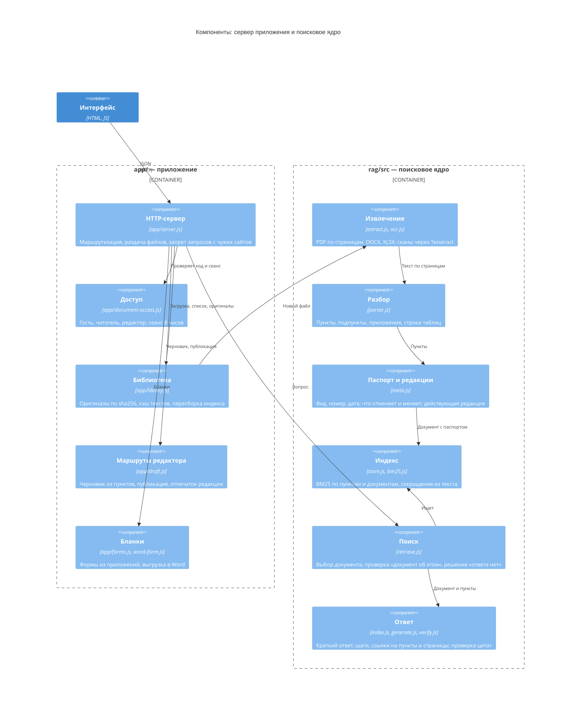
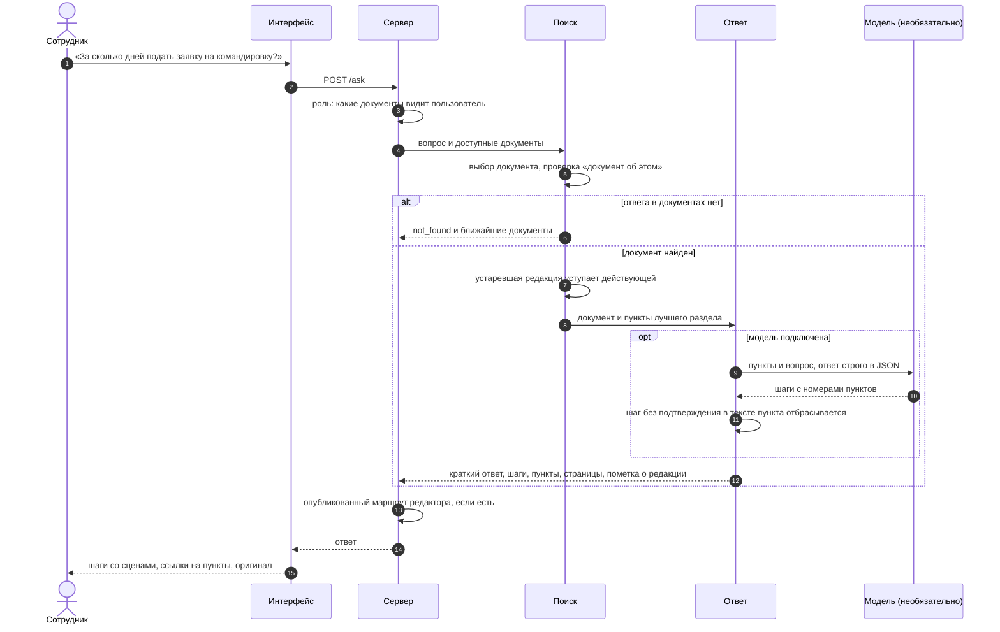
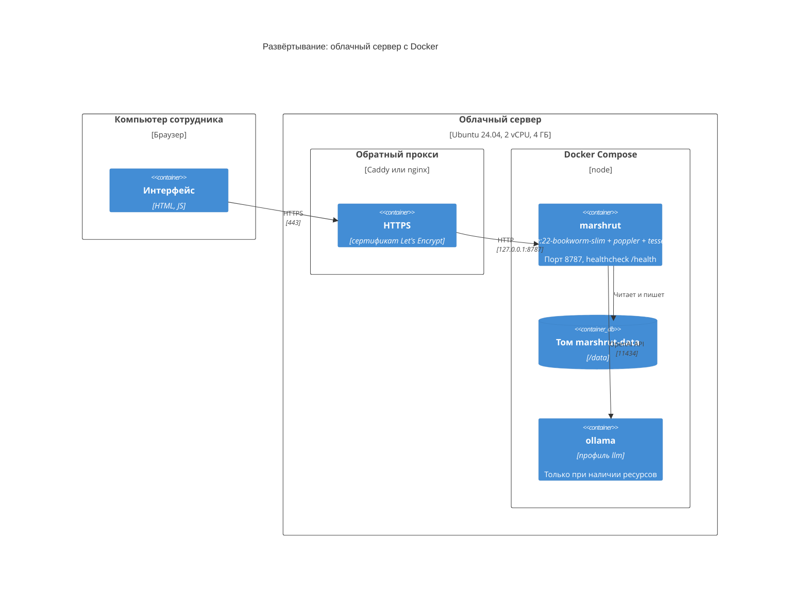

# Архитектура «Маршрута» в нотации C4

Схемы соответствуют коду в репозитории на 13.11.2026. Подробности по модулям, хранению и потокам данных — в [ARCHITECTURE.md](ARCHITECTURE.md).

## 1. Контекст

Кто пользуется системой и с чем она связана.

По умолчанию модель не подключена: ответ собирается из дословных выдержек пунктов, и данные никуда не уходят. Адрес модели вне локальной сети игнорируется, пока не задан `ALLOW_EXTERNAL_LLM=1`. Так соблюдается условие кейса: персональные данные (ФИО и должности из листов согласования) не передаются во внешние сервисы.

## 2. Контейнеры

Что запускается и где хранятся данные.

Индекс живёт в памяти процесса и пересобирается при загрузке документа: 700 документов — 2,8 с, ответ на вопрос — около 4 мс.

## 3. Компоненты сервера

Модули внутри контейнера «Сервер приложения».

## 4. Путь одного вопроса

## 5. Развёртывание

Без модели хватает сервера на 2 vCPU и 4 ГБ памяти. Документы поставки распознаются при сборке образа (около 2,5 минут), поэтому контейнер стартует сразу с готовым индексом. Для локальной модели 7B нужно не меньше 8 vCPU и 16 ГБ памяти.

## Решения и почему

| Решение | Почему |
|---|---|
| Решение «ответа нет» принимается до сборки ответа | Система не отвечает мимо регламентов: вопрос без подходящего документа до модели не доходит |
| BM25 и признаки документа вместо векторного поиска | Без модели эмбеддингов, работает офлайн, ответ за миллисекунды, результат объясним |
| Паспорт документа и связь редакций | В поставке есть две редакции одного регламента; ответ идёт по действующей с пометкой о предыдущей |
| Модель только локальная и необязательная | Условие кейса о персональных данных; без модели система полностью работает |
| Один процесс без npm-зависимостей | Простая сборка образа и нет уязвимостей сторонних пакетов |
| Сцены из готовых SVG-деталей | Подписи проверяемы, один стиль, рисуются мгновенно |
